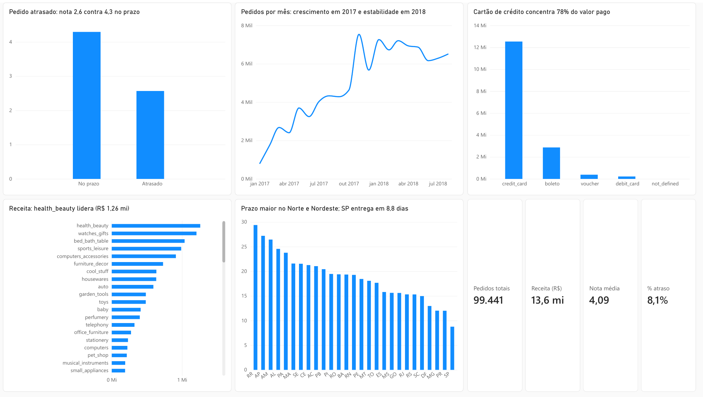

# Análise de e-commerce brasileiro (Olist)

Análise de pedidos de um marketplace brasileiro com SQL, Python e Power BI. A pergunta central: **entrega atrasada derruba a nota do cliente?** O passo a passo de cada etapa está em [`docs/`](docs/).

## Dados
[Brazilian E-Commerce Public Dataset by Olist](https://www.kaggle.com/datasets/olistbr/brazilian-ecommerce) (Kaggle, licença CC BY-NC-SA 4.0): pedidos de 2016 a 2018 em 9 tabelas relacionadas. Os dados não estão no repositório; baixe pelo link e coloque os CSVs em `data/raw/`.

## Principais resultados
- Pedidos entregues no prazo têm nota média 4,29; os entregues com atraso, 2,57.
- 8,1% dos pedidos entregues chegam depois do prazo prometido; o prazo médio de entrega é 12,6 dias.
- Os estados do Norte e Nordeste têm os piores prazos (PA: 23,8 dias; SP: 8,8).
- Cartão de crédito concentra 78,3% do valor pago.



## Andamento
- [x] 01 - [Exploração inicial](docs/01-exploracao-inicial.md)
- [x] 02 - [Perguntas de negócio](docs/02-perguntas-de-negocio.md)
- [x] 03 - [Limpeza com Python](docs/03-limpeza.md)
- [x] 04 - [Consultas SQL](docs/04-sql.md)
- [x] 05 - [Dashboard no Power BI](docs/05-dashboard.md)

## Como reproduzir
```
pip install pandas
python scripts/limpeza.py        # gera data/processed/
createdb olist
bash sql/load.sh olist
psql -d olist -f sql/02_consultas.sql
```
O painel foi feito no Power BI Desktop a partir de `data/processed/` (detalhes em `docs/05`). O arquivo `.pbix` não é versionado por causa do tamanho.
