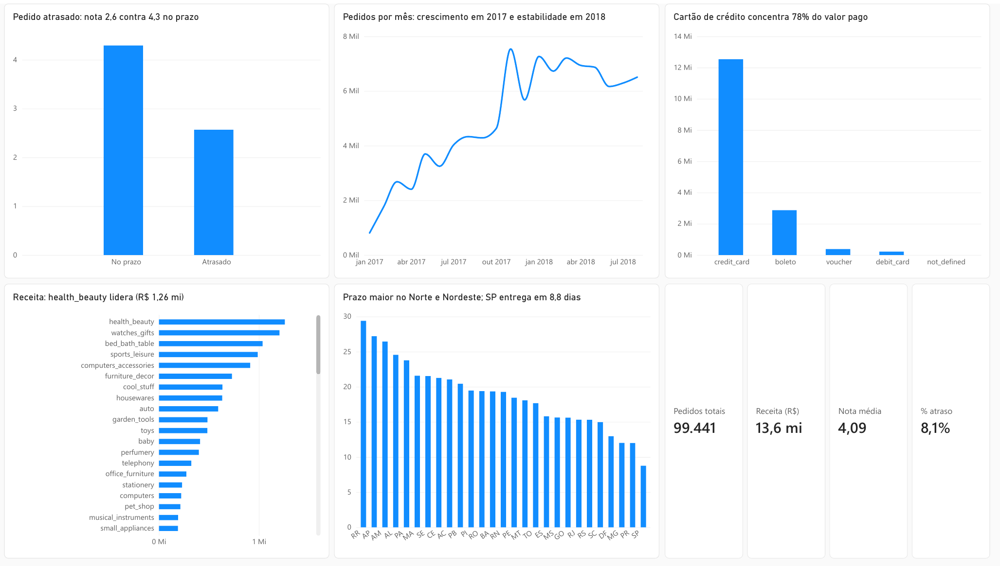

# 05 · Dashboard no Power BI



## Objetivo
Responder em uma página a pergunta central do projeto: entrega atrasada derruba a nota do cliente?

## O que o painel mostra
Cada gráfico tem como título a conclusão que ele sustenta.

1. **Pedido atrasado: nota 2,6 contra 4,3 no prazo.** Nota média por situação da entrega.
2. **Pedidos por mês: crescimento em 2017 e estabilidade em 2018.** Só jan/2017 a ago/2018, o período completo da base.
3. **Cartão de crédito concentra 78% do valor pago.**
4. **Receita: health_beauty lidera (R$ 1,26 mi).**
5. **Prazo maior no Norte e Nordeste; SP entrega em 8,8 dias.**
6. **Cartões:** 99.441 pedidos, R$ 13,6 mi de receita, nota média 4,09 e 8,1% de pedidos atrasados.

## Medidas e coluna criadas
```
Nota média = AVERAGE(order_reviews[review_score])
Pedidos = DISTINCTCOUNT(orders[order_id])
Receita = SUM(order_items[price])
Dias médios entrega = AVERAGE(orders[dias_para_entrega])
% atraso = DIVIDE(
    CALCULATE(DISTINCTCOUNT(orders[order_id]), orders[entregue_com_atraso] = TRUE()),
    CALCULATE(DISTINCTCOUNT(orders[order_id]), NOT ISBLANK(orders[entregue_com_atraso])))
Pedidos período completo = CALCULATE(DISTINCTCOUNT(orders[order_id]), orders[periodo_completo] = TRUE())
Nota média (entregues) = IF(ISBLANK(SELECTEDVALUE(orders[Entrega])), BLANK(), AVERAGE(order_reviews[review_score]))
Pedidos totais = FORMAT(DISTINCTCOUNT(orders[order_id]), "#,0")
Receita (R$) = FORMAT(SUM(order_items[price]) / 1000000, "0.0") & " mi"
```
Coluna calculada em `orders`, para o eixo do primeiro gráfico mostrar texto em vez de `False / True`:
```
Entrega = IF(ISBLANK(orders[entregue_com_atraso]), BLANK(),
    IF(orders[entregue_com_atraso] = TRUE(), "Atrasado", "No prazo"))
```
Os dois últimos são medidas de texto só para o cartão exibir "99.441" e "13,6 mi" com o rótulo certo.

## Problemas encontrados
- **Valores multiplicados por 100.** O Power BI em português leu o ponto decimal dos CSVs como separador de milhar (`health_beauty` apareceu com ~R$ 50 milhões). Defini a localidade de importação como Inglês (Estados Unidos) e redetectei os tipos. Os totais bateram com o SQL (doc 04).
- **Todas as barras com a mesma nota.** Na primeira versão da medida `Nota média (entregues)`, o filtro dentro do `CALCULATE` anulava o eixo do gráfico e todas as barras mostravam 4,29. Troquei por `SELECTEDVALUE`.
- **Barra "(Em branco)".** Pedidos sem data de entrega não têm situação de atraso. A medida acima os deixa de fora.
- **Meses incompletos.** A coluna `periodo_completo` (doc 03) limita a linha do tempo ao período completo.
- **Rótulos "Mi" e "Mil".** No Power BI em português, "Mi" é milhão e "Mil" é milhar.

## Limitações
- O gráfico de categorias mostra só as maiores na imagem (no arquivo há barra de rolagem).
- `not_defined` aparece em formas de pagamento com valor próximo de zero.
- Alguns relacionamentos usam filtro nos dois sentidos, para simplificar.

## Como reproduzir
1. Gere `data/processed/` com `python scripts/limpeza.py`.
2. No Power BI Desktop, importe cada CSV (*Obter dados > Texto/CSV*) com a localidade em Inglês (Estados Unidos).
3. Relacione as tabelas por `order_id`, `customer_id` e `product_id`, e crie as medidas acima.

O `.pbix` (~35 MB) não está no repositório; o painel está na imagem.
